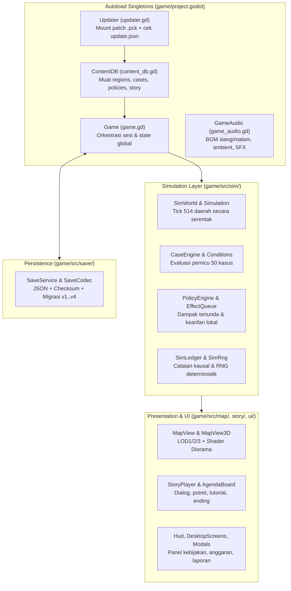

# NUSANTARA: Lima Tahun Menjaga Negeri

> **Karya Resmi Lomba IT-Competition AMIKOM Surakarta (IT-CAS) 2026 — Kategori Game Development (Mahasiswa)**  
> **Tema:** *“Inovasi Cerdas & Kearifan Lokal untuk Indonesia Emas”*  
> **Nama Tim:** **Saya Bangga Pernah Kuliah di AMIKOM Surakarta**

---

## Daftar Isi

1. [Rilis Terbaru & Tautan Unduhan (v1.0.2)](#rilis-terbaru--tautan-unduhan-v102)
2. [Ringkasan & Kesesuaian Tema](#ringkasan--kesesuaian-tema)
3. [Fitur Utama Permainan](#fitur-utama-permainan)
4. [Tech Stack & Perkakas](#tech-stack--perkakas)
5. [Arsitektur Sistem](#arsitektur-sistem)
6. [Sumber Data Real & Provenance](#sumber-data-real--provenance)
7. [Cara Bermain & Kontrol](#cara-bermain--kontrol)
8. [Struktur Repositori](#struktur-repositori)
9. [Pengujian & Build Rilis](#pengujian--build-rilis)
10. [Tim Pengembang](#tim-pengembang)
11. [Pernyataan Penggunaan AI (Ketentuan IT-CAS 2026)](#pernyataan-penggunaan-ai-ketentuan-it-cas-2026)

---

## Rilis Terbaru & Tautan Unduhan (v1.0.2)

Seluruh berkas rilis bersifat **mandiri (*standalone*)** dan **dapat dimainkan langsung tanpa instalasi perangkat lunak tambahan**.

* **Halaman Rilis Utama (Latest):** [GitHub Releases — v1.0.2](https://github.com/KurioSannn/GameSimulator/releases/tag/v1.0.2)
* **Manifest Auto-Updater:** [update.json](https://github.com/KurioSannn/GameSimulator/releases/latest/download/update.json)

| Platform | Tag Rilis Khusus | Tautan Unduhan Langsung | Ukuran | Batas Ketentuan IT-CAS |
| :--- | :--- | :--- | :---: | :---: |
| **Windows (10/11 64-bit)** | [v1.0.2-windows](https://github.com/KurioSannn/GameSimulator/releases/tag/v1.0.2-windows) | [NUSANTARA-1.0.2-windows.exe](https://github.com/KurioSannn/GameSimulator/releases/download/v1.0.2-windows/NUSANTARA-1.0.2-windows.exe) | ~217 MB | Maks 1 GB (Memenuhi) |
| **Android (7.0+ Mobile/Tablet)** | [v1.0.2-mobile](https://github.com/KurioSannn/GameSimulator/releases/tag/v1.0.2-mobile) | [NUSANTARA-1.0.2-android.apk](https://github.com/KurioSannn/GameSimulator/releases/download/v1.0.2-mobile/NUSANTARA-1.0.2-android.apk) | ~150 MB | Maks 250 MB (Memenuhi) |
| **macOS (Apple Silicon & Intel)** | [v1.0.2-macos](https://github.com/KurioSannn/GameSimulator/releases/tag/v1.0.2-macos) | [NUSANTARA-1.0.2-macos.zip](https://github.com/KurioSannn/GameSimulator/releases/download/v1.0.2-macos/NUSANTARA-1.0.2-macos.zip) | ~123 MB | Bonus Multiplatform |
| **Panduan Bermain (PDF)** | [v1.0.2](https://github.com/KurioSannn/GameSimulator/releases/tag/v1.0.2) | [Panduan_Bermain_NUSANTARA.pdf](https://github.com/KurioSannn/GameSimulator/releases/download/v1.0.2/Panduan_Bermain_NUSANTARA.pdf) | 381 KB | Wajib Sesuai Ketentuan |

> **Catatan Instalasi:**
> - **Windows:** Klik dua kali `.exe` untuk langsung bermain. Jika muncul *Windows Defender SmartScreen*, pilih **More info** → **Run anyway**.
> - **Android:** Buka berkas `.apk` dan izinkan *"Pasang aplikasi dari sumber tidak dikenal"*.
> - **macOS:** Ekstrak `.zip`, pindahkan `NUSANTARA.app` ke *Applications*, lalu buka melalui **Klik Kanan → Open** pada peluncuran pertama.
> - **Auto-Updater:** Game secara otomatis memeriksa pembaruan kecil (*patch `.pck`*) saat dibuka atau melalui tombol **PERIKSA PEMBARUAN** di menu *Pengaturan*.

---

## Ringkasan & Kesesuaian Tema

**NUSANTARA: Lima Tahun Menjaga Negeri** adalah gim simulasi tata kelola pemerintahan dan strategi berbasis data nyata Indonesia (*offline-first*). Pemain berperan sebagai **Presiden Nara Adinata** (tokoh fiktif) yang memimpin Indonesia selama satu masa bakti lima tahun (**20 kuartal**).

### Keterkaitan dengan Tema *"Inovasi Cerdas & Kearifan Lokal untuk Indonesia Emas"*
1. **Inovasi Cerdas Berbasis Data Nyata:** Mesin simulasi menghitung kondisi sosial, ekonomi, ketahanan pangan, kepercayaan publik, risiko bencana, dan kelestarian lingkungan di **38 provinsi dan 514 kabupaten/kota Indonesia secara individual dan serentak** setiap kuartal.
2. **Kearifan Lokal sebagai Solusi Strategis:** Mengangkat praktik kearifan lokal Nusantara (seperti *Subak* di Bali, *Sasi* di Maluku, *Awig-awig* di Lombok, *Panglima Laot* di Aceh, serta pengelolaan hutan adat) sebagai pilihan kebijakan yang memiliki dampak terukur terhadap keberlanjutan wilayah.
3. **Transparansi & Literasi Kebijakan:** Seluruh kasus faktual disertai atribusi sumber resmi yang dapat diperiksa langsung oleh pemain di dalam gim melalui *Mode Sumber Data*.

---

## Fitur Utama Permainan

- **Cakupan Geografis Penuh Indonesia:** 38 provinsi dan 514 kabupaten/kota dengan poligon peta multi-resolusi (LOD1, LOD2, LOD3) dalam mode **Diorama 3D** maupun **Peta 2D Ringan**.
- **50 Kasus Nyata & Naratif:** Diadaptasi dari peristiwa aktual Indonesia (bencana hidrometeorologi, krisis pangan, ketimpangan infrastruktur, konservasi lingkungan, tata kelola ekonomi daerah) dengan cabang cerita dan konsekuensi jangka panjang.
- **Alokasi Anggaran & Kebijakan Sektoral:** Pengaturan belanja negara (Pangan, Kesejahteraan, Mitigasi Bencana, Infrastruktur, Lingkungan) dan kebijakan regional yang saling memengaruhi (*causal ledger*).
- **4 Pilar Tujuan Masa Bakti & Rapor Warisan:** Evaluasi menyeluruh di akhir Tahun ke-5 yang membentuk warisan kepemimpinan pemain.
- **Kualitas Grafis Adaptif (D-097):** 3 preset (*Tinggi*, *Seimbang*, *Ringan*) dengan *auto step-down* otomatis bila FPS turun, pembatasan FPS cerdas (60/30/10 FPS) agar perangkat tidak panas, dan memori stabil di Android kelas menengah.
- **Sistem Simpanan & Auto-Update:** Simpan cepat (`F5`), muat cepat (`F9`), slot simpanan manual dengan checksum integritas, autosave saat keluar/jeda, serta pembaruan patch `.pck` terverifikasi SHA-256.

---

## Tech Stack & Perkakas

| Lapisan | Teknologi / Perkakas | Peran dalam Proyek |
| :--- | :--- | :--- |
| **Game Engine** | **Godot Engine 4.7** (`gl_compatibility`) | Engine lintas platform untuk rendering 3D/2D, UI, audio, dan ekspor `.exe`, `.apk`, `.zip`. |
| **Bahasa Pemrograman** | **GDScript** | Seluruh logika simulasi, engine cerita, pengendali peta, UI, simpanan, dan 184 *automated tests*. |
| **Shader & Grafis** | **GDShader** (`.gdshader` / `.gdshaderinc`) | Shader peta daratan, perairan samudra, awan, cuaca, garis pantai (*distance field*), dan properti 3D. |
| **Pipeline Data & GIS** | **Python 3** | Normalisasi data statistik resmi dan pembentukan geometri peta GeoJSON/LOD dari data spasial BIG & BPS. |
| **Desain UI & Aset** | **Figma**, **Kenney (CC0)**, **Google Fonts** | Tata letak antarmuka, ikonografi, model 3D dekorasi CC0, serta tipografi berlisensi SIL Open Font License. |
| **Kolaborasi & Rilis** | **Git**, **GitHub Releases**, **Android Keystore** | Kontrol versi, skrip build rilis otomatis (`scripts/release/build_release.sh`), penandatanganan APK, dan distribusi patch. |

---

## Arsitektur Sistem

Arsitektur **NUSANTARA** memisahkan secara tegas antara **lapisan data mentah**, **mesin simulasi deterministik**, **lapisan presentasi peta 3D/2D**, dan **antarmuka pengguna (UI)**. UI tidak pernah menyimpan atau mengubah kebenaran status simulasi secara langsung.



### Rincian Modul Utama (`game/src/`)
- **`app/`** (`main.gd`, `game.gd`, `updater.gd`): Siklus hidup aplikasi, *in-game auto-updater* (yang berjalan sebagai autoload pertama sebelum sumber daya lain dimuat), pintasan keyboard/back Android, dan skrip QA headless.
- **`sim/`** (`simulation.gd`, `sim_world.gd`, `case_engine.gd`, `policy_engine.gd`, `sim_ledger.gd`, `sim_rng.gd`): Mesin simulasi kuartal yang sepenuhnya deterministik (*seeded*), memproses seluruh 514 kabupaten/kota tanpa *per-node `_process()`*.
- **`map/`** (`map_view.gd`, `map_view_3d.gd`, `map_lod.gd`, `map_camera_3d.gd`, `diorama_*.gd`, `*.gdshader`): Sistem pemetaan LOD adaptif, kontrol kamera desktop & sentuh, serta dekorasi diorama 3D (pesawat, kapal, jalan raya, atmosfer siang/malam, cuaca).
- **`story/`** (`campaign.gd`, `story_player.gd`, `agenda_board.gd`, `ending_evaluator.gd`, `tutorial_coach.gd`): Penggerak narasi kampanye 5 tahun, reaksi pilihan, sistem mandat/warisan, dan pemandu tutorial awal.
- **`ui/`** (`hud.gd`, `desktop_screens.gd`, `case_modal.gd`, `region_panel.gd`, `budget_panel.gd`, `policy_panel.gd`, `settings_view.gd`, `startup_splash.gd`): Seluruh tampilan antarmuka reaktif, termasuk menu utama, tombol keluar + autosave, dan layar pengaturan grafis/pembaruan.
- **`save/`** (`save_service.gd`, `save_codec.gd`): Serialisasi simpanan dengan validasi checksum dan pemulihan cadangan otomatis.

---

## Sumber Data Real & Provenance

Seluruh data awal dan referensi geografis dikelola dengan prinsip **immutabilitas data mentah** (`data/raw/`) dan **pencatatan asal-usul data (*provenance metadata*)** pada `data/catalog/source_registry.csv` serta `research/sources/`.

| ID Sumber | Institusi Resmi | Dataset / Dokumen | Domain | Status |
| :--- | :--- | :--- | :--- | :--- |
| `SRC-0001` | **Badan Informasi Geospasial (BIG)** | `BATAS_KABKOTA_AR` (Batas Administrasi Kab/Kota) | Geografi & Poligon Peta | Terverifikasi |
| `SRC-0002` | **Badan Pusat Statistik (BPS)** | SIG Bridging Kode Wilayah BPS–Kemendagri | Pemetaan Kode Wilayah | Terverifikasi |
| `SRC-0007` | **Badan Informasi Geospasial (BIG)** | `BATAS_WILAYAH` Layer 8 (Batas Provinsi) | Validasi Lintas Provinsi | Terverifikasi |
| `SRC-0008` | **Badan Pusat Statistik (BPS)** | Tabel Luas Daerah dan Jumlah Pulau 2024/2025 | Data Dasar Wilayah | Terverifikasi |
| `SRC-0003` / `0006` | **Kementerian Dalam Negeri** | Kepmendagri 300.2.2-2138/2025 & Pembaruan 2025 | Kode & Nama Wilayah | Referensi Regulasi |
| **BNPB & BMKG** | **BNPB / BMKG** | Indeks Risiko Bencana Indonesia (IRBI) & Historis Kejadian | Kalibrasi Risiko Bencana | Terverifikasi |

> **Pemisahan Fakta & Simulasi:** Data baseline wilayah dan latar belakang kasus diadaptasi dari sumber publik resmi. Namun, tokoh **Presiden Nara Adinata**, jalan cerita fiktif, serta dampak masa depan setelah pemain mengambil keputusan merupakan **hasil simulasi** dan ditandai secara eksplisit di dalam gim.

---

## Cara Bermain & Kontrol

Panduan lengkap bergambar tersedia pada berkas **[Panduan_Bermain_NUSANTARA.pdf](./Panduan_Bermain_NUSANTARA.pdf)**.

- **Geser Peta:** Seret Klik Kiri / `WASD` / Tombol Panah / Usap 1 jari (Mobile)
- **Zoom & Reset:** Scroll Mouse / Cubit (*Pinch*) / `+` & `−` / `Home` (Seluruh Indonesia)
- **Putar Peta 3D:** Tahan Klik Kanan atau `Q` / `E`
- **Aksi Cepat:** `Spasi` atau `Enter` (Lanjut Kuartal) · `P` (Kebijakan) · `B` (Anggaran) · `L` (Catatan Peristiwa) · `T` (Mode 2D/3D)
- **Simpan & Muat:** `F5` (Simpan Cepat) · `F9` (Muat Cepat) · `Ctrl+S` (Simpan Slot Baru)
- **Keluar Permainan:** Tombol **KELUAR** pada Menu Utama atau menu **`☰` → Keluar** (progres disimpan otomatis).

---

## Struktur Repositori

```text
NUSANTARA/
├── README.md                              # Dokumentasi utama proyek & kepatuhan IT-CAS 2026
├── Panduan_Bermain_NUSANTARA.pdf          # Panduan singkat cara bermain (PDF resmi lomba)
├── ITCAS_2026_Game_Development_Guidebook.pdf
├── Mainkan NUSANTARA.cmd                  # Launcher cepat untuk pengujian lokal di Windows
├── game/                                  # Proyek utama Godot Engine 4.7
│   ├── project.godot
│   ├── export_presets.cfg                 # Konfigurasi ekspor Windows, macOS, dan Android
│   ├── assets/                            # Aset UI, potret, latar cerita, audio, dan model 3D
│   ├── data/                              # Data game-ready (regions, baseline, 50 kasus, kebijakan, cerita)
│   ├── src/                               # Kode sumber GDScript & GDShader (app, sim, map, story, ui, save)
│   └── tests/                             # 184 pengujian otomatis (run_tests.gd)
├── data/                                  # Data mentah, ternormalisasi, dan katalog provenance
├── research/                              # Kartu sumber data (SRC-*), riset kasus, dan laporan QA
├── scripts/                               # Pipeline data Python, validator, dan builder rilis
└── docs/                                  # Spesifikasi desain, arsitektur, pengujian, dan rilis
```

---

## Pengujian & Build Rilis

### Menjalankan Seluruh Test Suite (184 Pengujian)
```sh
tools/Godot.app/Contents/MacOS/Godot --headless --path game -s res://tests/run_tests.gd
```

### Membuat Build Rilis Multiplatform & Patch
```sh
# Build rilis penuh (Windows .exe, macOS .zip, Android .apk)
scripts/release/build_release.sh <versi>

# Build patch pembaruan ringan (.pck) terhadap versi dasar
scripts/release/build_release.sh <versi_baru> --patch <versi_dasar>
```

---

## Tim Pengembang

**Nama Tim:** **Saya Bangga Pernah Kuliah di AMIKOM Surakarta**

1. **Galih** — *Game Director*, Integrasi Teknis, Pemrograman Simulasi & Sistem Engine
2. **Ananda** — Desain Karakter & Aset Visual
3. **Cleo** — Desain Antarmuka (UI/UX), Aset Grafis & Tata Letak

---

## Pernyataan Penggunaan AI (Ketentuan IT-CAS 2026)

Sesuai dengan ketentuan penggunaan AI pada panduan lomba **IT-Competition AMIKOM Surakarta (IT-CAS) 2026**, tim **Saya Bangga Pernah Kuliah di AMIKOM Surakarta** menyatakan secara transparan bahwa perangkat AI generatif (**ChatGPT / Claude**) digunakan **sebatas sebagai alat bantu untuk *brainstorming*, riset awal, dan penyusunan ide** (seperti eksplorasi kerangka konsep simulasi, pemetaan referensi dataset resmi, serta perumusan variasi skenario edukatif).

Seluruh proses kreatif inti, arsitektur dan implementasi kode gim, desain visual dan antarmuka, validasi data statistik resmi, serta keputusan akhir karya dikerjakan langsung dan dipertanggungjawabkan sepenuhnya oleh anggota tim.
